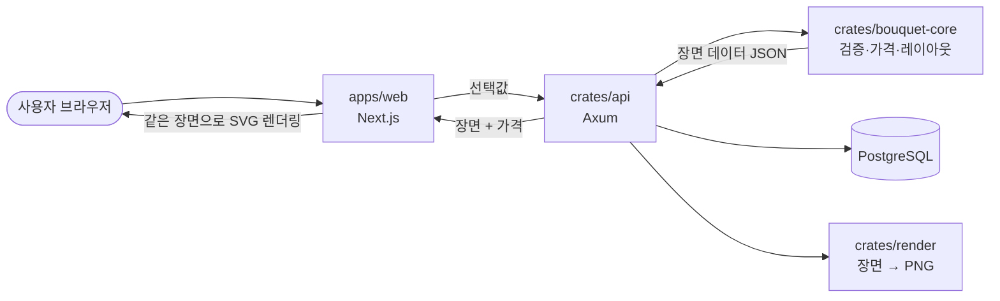

# posy

꽃 선물 초보를 위한 꽃다발 미리보기 서비스

> 🚧 개발 중입니다. 현재 Phase 1(레포 스캐폴딩)을 진행하고 있어요.

## 어떤 서비스인가요?

꽃 선물을 거의 해본 적 없는 사람은 어떤 꽃을 어떻게 조합하면 어떤 모습이 되는지, 얼마쯤 드는지 감을 잡기 어려워요. 글로 된 설명만으로는 상상이 잘 안 되고요.

posy에서는 이걸 고르면

- 꽃 종류와 색
- 꽃별 송이 수
- 꽃다발 모양 (라운드 / 원사이드 / 내추럴 / 한 송이)
- 크기 (S / M / L)

이걸 볼 수 있어요.

- 완성된 꽃다발 미리보기 (2D)
- 대략적인 가격 범위
- 꽃말 (한국 꽃말 / 서양 꽃말)

결과는 이미지로 저장하거나 링크로 공유해서 꽃집에 보여줄 수 있어요. 로그인은 필요 없어요.

> 실제 꽃다발은 꽃집과 시즌에 따라 모양·색·가격이 달라질 수 있어요.

## 스크린샷

(Phase 5 이후 추가 예정)

## 아키텍처



- 백엔드가 **장면 데이터**(꽃별 위치·회전·크기·레이어 순서·포장지)를 계산하고, 웹(SVG)과 서버(PNG)가 같은 장면 데이터로 그려요.
- 같은 입력과 같은 seed면 항상 같은 결과가 나와요. seed를 바꾸면 자연스러운 변형이 나와요.
- 꽃 그래픽은 이미지 에셋 대신 코드로 그린 파라미터 기반 SVG예요. 색을 자유롭게 바꿀 수 있고 저작권 걱정이 없어요.

현재 구현된 부분은 `bouquet-core`(빈 크레이트)와 `apps/web`(기본 골격)이에요. `api`는 Phase 4, `render`는 Phase 6에서 추가해요.

## 기술 스택

| 영역 | 기술 |
|---|---|
| 도메인 로직 | Rust (edition 2024) |
| API | Rust, Axum, sqlx, PostgreSQL |
| 웹 | Next.js (App Router), TypeScript, Tailwind CSS |
| 테스트 | cargo test, Vitest, Testing Library |
| 도구 | Cargo workspace, pnpm workspace, just, GitHub Actions |

기술을 고른 이유는 [docs/adr](docs/adr)에 기록해요.

## 실행 방법

### 준비물

| 도구 | 버전 | 비고 |
|---|---|---|
| Rust | 1.100.0 | [rustup](https://rustup.rs)만 설치하면 `rust-toolchain.toml`에 따라 자동으로 맞춰져요 |
| Node | 24 | `.nvmrc` 참고 (`nvm use`) |
| pnpm | 12.23.0 | `npm install -g pnpm@12.23.0` |
| just | 최신 | `cargo install just --locked` |

### 명령

```bash
pnpm install              # 웹 의존성 설치
just check                # 전체 검사 (Rust fmt·clippy·test + 웹 lint·test·build)
pnpm --filter web dev     # 웹 개발 서버 (http://localhost:3000)
```

## 레포 구조

```
crates/bouquet-core   순수 Rust 도메인 로직 (I/O 없음)
apps/web              Next.js 웹 앱
docs/adr              기술 결정 기록 (ADR)
docs/devlog           Phase별 회고와 학습 노트
```

## 개발 기록과 트러블슈팅

Phase별로 무엇을 배웠고 어디서 막혔는지 [docs/devlog](docs/devlog)에 남기고 있어요.

## 라이선스

[MIT](LICENSE)
